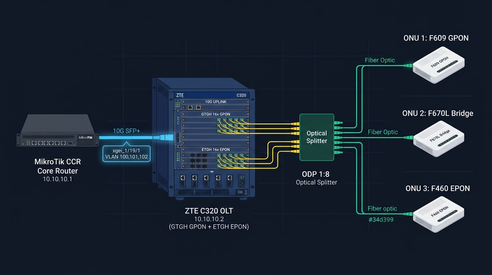
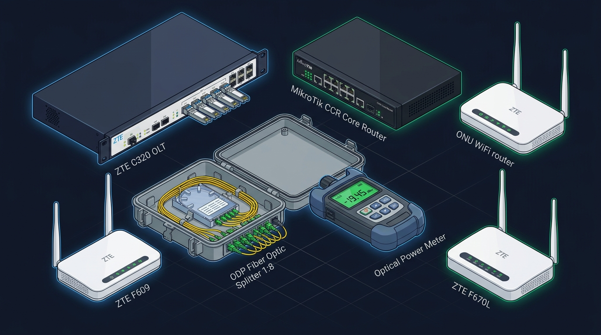
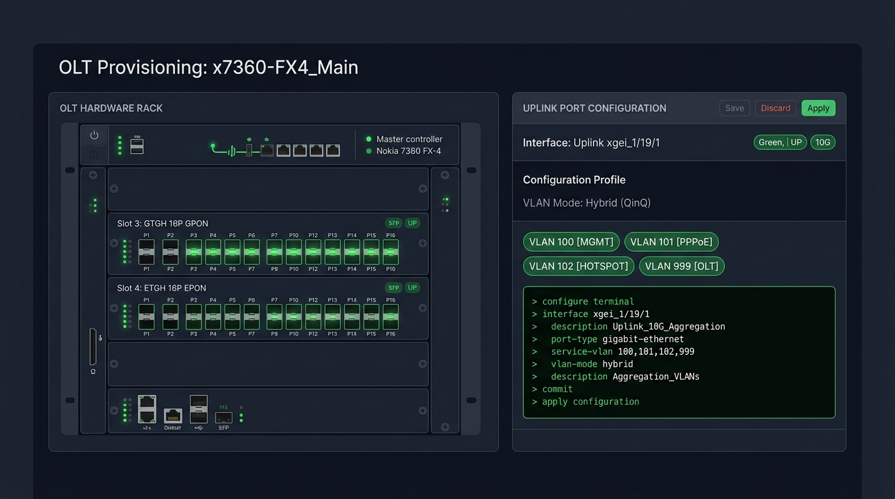
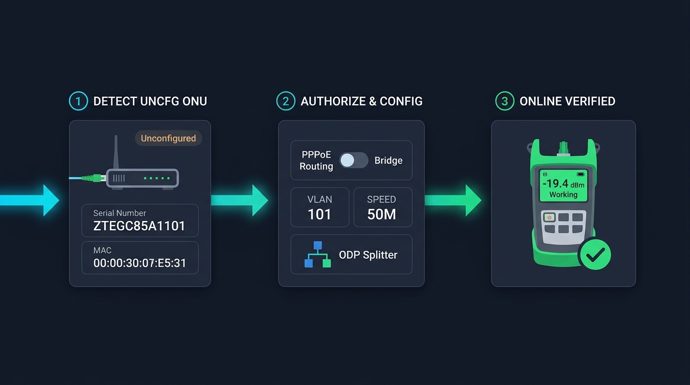

# Dokumentasi Registrasi & Konfigurasi OLT ZTE C300/C320 (GPON GTGH & EPON ETGH)

Panduan praktis registrasi perangkat OLT, konfigurasi VLAN & Uplink, aktivasi Port PON, otorisasi ONU (GPON & EPON), Auto-Provisioning, serta contoh **alat dummy** siap uji lab.

---

## 1. Topologi & Inventaris Alat Dummy Lab





### Daftar Alat Dummy

| Perangkat | Model / Board | IP / SN / MAC Dummy | Interface / Lokasi | Keterangan & Layanan |
| :--- | :--- | :--- | :--- | :--- |
| **Router Core (BRAS)** | MikroTik CCR1036-12G-4S | `10.10.10.1/24` | `sfp-sfpplus1` (10G) | PPPoE Server (VLAN 101), Hotspot (VLAN 102), ACS TR-069 (VLAN 100), OLT Mgmt (VLAN 999) |
| **OLT Utama** | ZTE ZXA10 C320 V2.1.0 | `10.10.10.2` (Telnet `23`) | `xgei_1/19/1`, Slot 3 `GTGH`, Slot 2 `ETGH` | User Telnet: `zte` / `zxr10`, Uplink Hybrid VLAN `100,101,102,999` |
| **Splitter ODP** | PLC Splitter 1:8 SC/APC | `ODP-LBK-01` | Zone `Lebak-Utara` / `RK-01` | Redaman splitter ±10.5 dB, target RX ONU `-18` s/d `-23 dBm` |
| **ONU Dummy #1** | ZTE F609 V3 (GPON) | SN: `ZTEGC85A1101` | `gpon-onu_1/3/1:1` | Mode **Routing PPPoE**, VLAN `101`, `cust_budi01@isp.net`, 50M, RX `-19.45 dBm` |
| **ONU Dummy #2** | ZTE F670L (GPON) | SN: `ZTEGC85A2202` | `gpon-onu_1/3/1:2` | Mode **Bridging**, VLAN `102`, 100M, RX `-21.10 dBm` |
| **ONU Dummy #3** | ZTE F460 (EPON / ETGH) | MAC: `c85a.9f11.2233` | `epon-onu_1/2/1:1` | Mode **Routing PPPoE**, VLAN `101`, `cust_sinar03@isp.net`, 50M, RX `-20.30 dBm` |

### Contoh Konfigurasi MikroTik Core (Dummy Lab)

```routeros
/interface vlan
add interface=sfp-sfpplus1 name=vlan100-mgmt vlan-id=100
add interface=sfp-sfpplus1 name=vlan101-pppoe vlan-id=101
add interface=sfp-sfpplus1 name=vlan102-hotspot vlan-id=102
add interface=sfp-sfpplus1 name=vlan999-olt vlan-id=999

/ip address
add address=10.10.10.1/24 interface=vlan999-olt comment="OLT Management"
add address=10.69.69.1/24 interface=vlan100-mgmt comment="TR-069 ACS"

/ip pool
add name=pool-pppoe ranges=100.64.1.2-100.64.1.254

/ppp profile
add name=prof-50M local-address=100.64.1.1 remote-address=pool-pppoe rate-limit=50M/50M

/interface pppoe-server server
add interface=vlan101-pppoe service-name=PPPOE-OLT default-profile=prof-50M disabled=no

/ppp secret
add name=cust_budi01@isp.net password=budi12345 service=pppoe profile=prof-50M
add name=cust_sinar03@isp.net password=sinar12345 service=pppoe profile=prof-50M
```

---

## 2. Registrasi OLT, VLAN, Uplink & Aktivasi PON Port



### Langkah-langkah di Aplikasi Web
1. **Tambah OLT**: Buka menu **OLTs → + Add OLT**. Isi `Name` (`OLT-LAB-C320`), `IP Address` (`10.10.10.2`), `Telnet Port` (`23`), kredensial Telnet & Enable Password, serta pilih `Supported PON Types` (`GPON`, `EPON`, atau `GPON+EPON`).
2. **Sync Live dari OLT**: Klik **Sync Data & Config dari OLT (Telnet)** agar card (`GTGH` / `ETGH`), port PON, uplink, VLAN, dan ONU eksisting langsung tertarik.
3. **Buat VLAN**: Masuk ke tab **VLANs → Add VLAN** untuk VLAN `100` (MGMT/TR-069, nonaktifkan NAT), `101` (PPPoE), `102` (Hotspot/Bridge), dan `999` (OLT Mgmt).
4. **Tagging VLAN ke Uplink**: Masuk ke tab **Uplink → Configure** pada `xgei_1/19/1`, pilih Mode `Hybrid`, centang VLAN `100, 101, 102, 999`, lalu klik **Save & Tag VLANs on Uplink**.
5. **Aktifkan Port PON**: Masuk ke tab **PON ports**, pilih slot `GTGH` atau `ETGH`, lalu klik **Enable** (`no shutdown` & `linktrap enable`).
6. **Master Data & RBAC**: Daftarkan **Speed & ONU Types**, **Zones**, **Sectors (RK)**, **Splitters (ODP)**, dan akun operator/teknisi di **Users & Hak Akses** (role `ADMIN`, `OPERATOR`, `TECHNICIAN`, atau `VIEWER`).

### Contoh CLI ZTE — VLAN, Uplink & PON Port

```text
configure terminal
vlan 100
  name MGMT_TR069
exit
vlan 101
  name PPPOE_CUST
exit
vlan 102
  name HOTSPOT_BRIDGE
exit
vlan 999
  name OLT_MGMT
exit

interface xgei_1/19/1
  description "UPLINK-MIKROTIK-CCR"
  phy-attribute lan
  no shutdown
  hybrid-attribute fiber
  no negotiation auto
  speed 10000
  duplex full
  switchport mode hybrid
  switchport default vlan 1
  switchport vlan 100,101,102,999 tag
  port-protect disable
  uplink-isolate disable
exit

! Aktifkan Port PON GPON (GTGH) & EPON (ETGH)
interface gpon-olt_1/3/1
  no shutdown
  linktrap enable
  description "ODC-LEBAK-UTARA-01"
exit
interface epon-olt_1/2/1
  no shutdown
  linktrap enable
  description "ODC-EPON-PASAR-01"
exit
end
write
```

---

## 3. Registrasi / Authorize ONU (GPON GTGH & EPON ETGH)



### Alur Registrasi ONU
1. Hubungkan kabel fiber ONU dummy ke ODP (`ODP-LBK-01`).
2. Buka menu **Unconfigured ONUs** lalu klik **Scan Live** (aplikasi menjalankan `show gpon onu uncfg` untuk GTGH dan `show onu unauthentication` untuk ETGH).
3. Klik **Authorize** pada ONU yang terdeteksi:
   - **Mode Routing (PPPoE)**: Masukkan VLAN `101`, Username/Password PPPoE, Speed Profile `50M-DOWN`, SSID WiFi, dan opsi TR-069 ACS.
   - **Mode Bridging**: Pilih `Bridging`, VLAN `102`, dan Speed Profile `100M-DOWN`.
   - Pilih lokasi **Zone → RK → ODP Splitter**.
4. Klik **Save & Authorize ONU** — aplikasi otomatis mendorong CLI ke OLT dan menyimpan konfigurasi (`write`).

### Contoh CLI Hasil Authorize — ONU Dummy #1 (ZTE F609 · GPON GTGH · Routing PPPoE)

```text
configure terminal
interface gpon-olt_1/3/1
  onu 1 type ZTE-F609 sn ZTEGC85A1101
exit
interface gpon-onu_1/3/1:1
  name BUDI-SANTOSO-01
  description "Jl. Merdeka No.12 - ODP-LBK-01 Port 1"
  tcont 1 profile SMARTOLT-1G-UP
  gemport 1 tcont 1
  gemport 1 traffic-limit downstream 50M-DOWN
  service-port 1 vport 1 user-vlan 101 vlan 101
exit
pon-onu-mng gpon-onu_1/3/1:1
  service 1 gemport 1 vlan 101
  wan-ip 1 mode pppoe username cust_budi01@isp.net password budi12345 vlan-profile vlan101 host 1
  wan 1 ethuni 1 2 3 4 ssid 1 service internet
  ssid ctrl 1 name JETCYBER-BUDI01
  ssid auth wpa 1 wpa2-psk key password123
exit
end
write
```

### Contoh CLI Hasil Authorize — ONU Dummy #3 (ZTE F460 · EPON ETGH · Routing PPPoE)

```text
configure terminal
interface epon-olt_1/2/1
  onu 1 type ZTE-F460 mac c85a.9f11.2233
exit
interface epon-onu_1/2/1:1
  name TOKO-SINAR-03
  description "Jl. Pasar Baru No.5 - ODP-EPON-01 Port 1"
  switchport mode trunk
  switchport vlan 101 tag
exit
pon-onu-mng epon-onu_1/2/1:1
  auto-config
  pppoe 1 username cust_sinar03@isp.net password sinar12345 mode auto nat enable vlan 101
exit
end
write
```

---

## 4. Standar Verifikasi Optik & Troubleshooting

| Kondisi Sinyal RX ONU | Status | Tindakan |
| :--- | :--- | :--- |
| **`-15 dBm` s/d `-24 dBm`** | Optimal (`Working`) | Normal, koneksi PPPoE stabil. |
| **`-25 dBm` s/d `-27 dBm`** | Warning | Bersihkan konektor SC/APC di ODP, cek tekukan kabel dropcore. |
| **`< -28 dBm` / `LOS`** | Kritis (Offline) | Kabel fiber putus/tercabut antara ODP dan rumah pelanggan. |
| **`DyingGasp`** | Power Fail | Adaptor listrik/ONU di rumah pelanggan mati. |

### Perintah Verifikasi Harian di OLT

```text
show card
show gpon onu state
show onu all-status
show pon power onu-rx gpon-olt_1/3/1
show pon power onu-rx epon-olt_1/2/1
show running-config interface xgei_1/19/1
show gpon onu detail-info gpon-onu_1/3/1:1
show onu detail-info epon-onu_1/2/1:1
```
